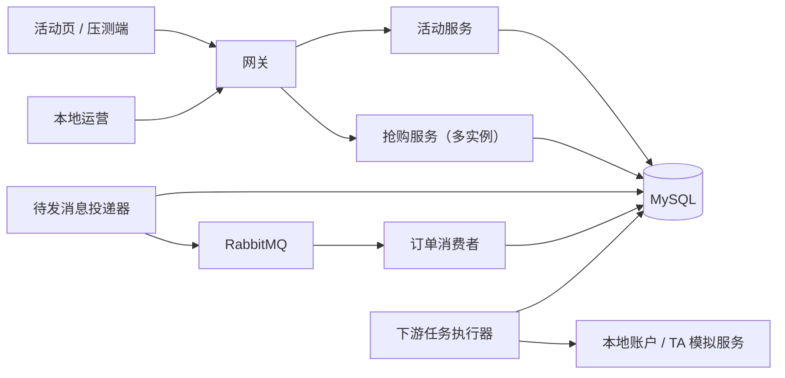
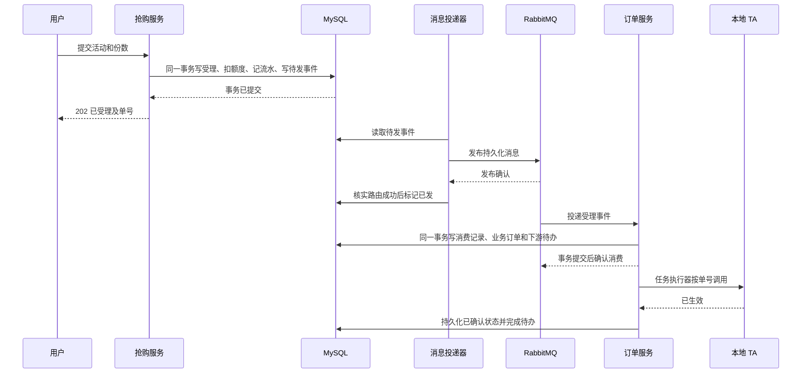
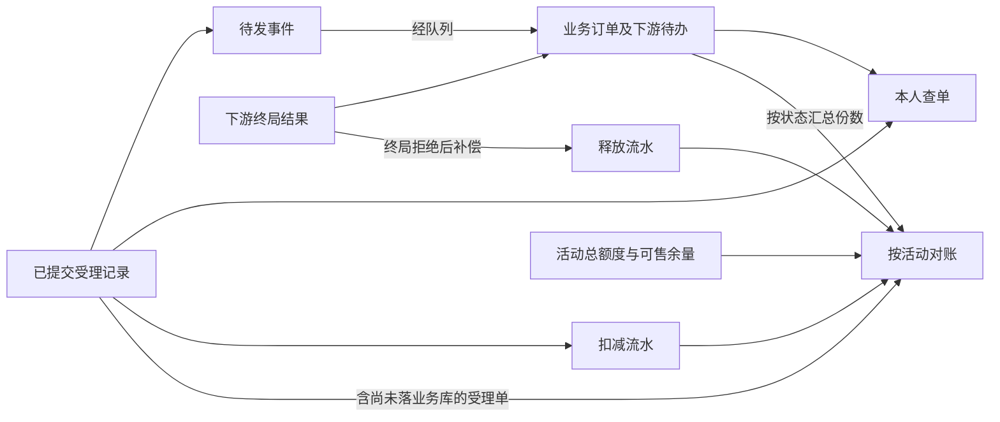

# 限量产品预约抢购系统规格说明

**评审草案 v0.1 · 2026-11-19**

系统用 Java 承接限量产品开抢时的突发流量。抢购入口负责判定资格、占用额度并返回单号，订单服务异步写业务订单并调用本地账户／TA 模拟服务。用户应能查到自己是否抢到，运营人员应能按流水核对每一份额度，服务中断后应能从持久化记录继续处理。[题目原文，第 1–3 页](<../题目2：实现一个限量产品预约抢购系统 (1).pdf>) · [两周实施计划](superpowers/plans/2026-11-19-限量产品预约抢购系统实施计划.md)

## 1. 业务范围与规则

| 事项 | 对外行为 |
|---|---|
| 活动管理 | 运营人员创建活动，配置产品、初始总额度、单人限购数、开抢时间。总额度和限购数均为正整数，额度单位为“份”。活动创建后为草稿，可上线、下线。 |
| 开抢条件 | 新申购必须同时满足活动已上线、数据库时间已到开抢时刻、用户身份有效，以及申购份数为正整数且在限购范围内。开抢时刻本身允许申购。接口时间使用带时区偏移的格式。 |
| 一人一单 | 本版拟定同一用户在同一活动只受理一笔申购，一单可以购买多份。相同份数重试可查回原单，变更份数重提则提示已有申购。首次未获受理的请求不占用资格。 |
| 整单扣额 | 余量足够才受理整笔申购。仅余 2 份时申请 3 份，应提示份数不足并保留 2 份，后续申请 1 份的用户仍可抢购。余量为 0 时才提示售罄。 |
| 活动上下线 | 草稿可上线，已上线可下线，已下线可重新上线。重复设置同一状态返回当前结果。重新上线沿用原配置和余量。下线与新扣减按同一活动在数据库中的生效顺序裁决，已受理订单继续履约、查单或补偿。 |
| 前端与下游 | 简单活动页展示活动状态、开抢时间、限购数、申购入口和本人结果。账户／TA 统一使用本地模拟服务，支持正常、延迟、不可用、明确拒绝，以及已生效后丢失响应。 |

**基线技术选型**沿用计划中的 Spring Boot、MySQL 和 RabbitMQ。Java 及本地下游是题面约束，具体数据库和消息队列是本草案的项目选择。库存分片、退单后的候补递补，以及积压或失败率异常时自动暂停额度发放并输出指标属于加分范围。下游自动降级、积压和死信验证属于必做范围。

## 2. 用户能查到的状态与库存口径

| 对外状态 | 已经发生的事实 | 额度处理 | 下一状态 |
|---|---|---|---|
| `ACCEPTED` 已受理 | 受理记录、扣减流水和待发消息已在同一事务提交。此时已有单号，业务订单可能尚未入库。 | 已扣一次 | `PENDING_TA` |
| `PENDING_TA` 待下游确认 | 业务订单和下游待办已一并入库。等待调用、重试或人工核查都可停留在此状态。 | 继续占用 | `CONFIRMED` 或 `RELEASED` |
| `CONFIRMED` 已确认 | 本地下游已按原单号生效，订单服务已持久化确认结果。按此状态统计最终有效订单数。 | 已售出，确认动作不再扣减 | 终态 |
| `RELEASED` 已释放 | 下游对原单给出了可复查、不可再变成成功的终局拒绝。订单终态、释放流水和余量增加已在同一事务提交。 | 原份数只释放一次 | 终态 |

查询使用主库受理记录关联业务订单。受理记录存在、业务订单尚未生成时即可查到 `ACCEPTED`。售罄、下线和释放后仍保留受理记录与业务键，因此迟到的重试始终能定位原单。下游超时、查询暂未找到结果或转入人工核查期间，额度继续保留。

对同一活动在同一数据库快照中按**份数**对账。`扣减`、`释放`流水的份数均记正数，由类型表达方向。

- `可售余量 = 初始总额度 − 扣减流水份数之和 + 释放流水份数之和`，且 `0 ≤ 可售余量 ≤ 初始总额度`。
- `初始总额度 = 可售余量 + 已受理份数 + 待下游确认份数 + 已确认份数`。四项按互斥状态统计。
- 每个受理单有且仅有一条扣减流水，最多一条等额释放流水。同一活动、同一用户最多一个受理单号。报告分别列出“笔数”和“份数”。

## 3. 接口契约

本地演示和压测通过 `X-User-Id` 提供测试用户身份。个人下单、查单均从该身份取得用户 ID。服务为每次 HTTP 请求生成或接收 `X-Request-Id` 以关联日志，业务幂等键由服务端取 `(activityId, userId)`。不同请求 ID、不同服务实例的点击按同一业务键裁决。

| 方法和路径 | 输入 | 成功结果 |
|---|---|---|
| `POST /api/activities` | `productId`、`totalQuota`、`perUserLimit`、`startsAt` | `201`，返回 `activityId` 和 `DRAFT`。初始余量等于总额度。 |
| `PUT /api/activities/{id}/status` | 目标 `ONLINE` 或 `OFFLINE` | `200`，返回实际状态。合法转换见第 1 节。 |
| `GET /api/activities/{id}` | 活动 ID | `200`，返回产品、活动状态、开抢时间、限购数和展示余量。 |
| `POST /api/activities/{id}/purchases` | 本人身份及 `{"quantity":1}` | 首次受理 `202`，返回单号和 `ACCEPTED`。已有同份数受理记录时返回 `200`、原单号和当前状态。 |
| `GET /api/activities/{id}/purchases/me` | 本人身份 | `200`，返回本人原单号、份数和当前状态。尚无可见的已提交受理记录时返回 `404 PURCHASE_NOT_FOUND`。 |
| `PUT /mock/ta/orders/{orderId}`、`GET /mock/ta/orders/{orderId}` | 写入时携带活动、用户和份数，查询时使用原单号 | 已有终局结果时返回 `200` 和持久化的 `APPLIED` 或 `REJECTED`。相同单号、相同内容重放返回同一结果，内容不一致返回 `409`。查询尚无记录时返回 `404`。 |

首次受理的响应示例如下，调用方可用同一身份和活动查回单号。

```json
{"requestId":"req-001","activityId":"act-demo","orderId":"ord-001","quantity":1,"status":"ACCEPTED"}
```

错误体统一包含 `requestId`、稳定的 `code` 和可直接展示的中文 `message`。已找到原单的份数冲突额外返回 `orderId`。

| HTTP | 业务码 | 调用方应如何处理 |
|---|---|---|
| `400 / 401` | `INVALID_ARGUMENT` / `USER_REQUIRED` | 修正无效份数、时间或状态值，或补齐本地测试身份。 |
| `404` | `ACTIVITY_NOT_FOUND` / `PURCHASE_NOT_FOUND` | 核对活动。首次下单结果未知时，个人查询暂未找到记录，可稍后查单或按原身份和份数重试。 |
| `409` | `NOT_OPEN` / `OFFLINE` / `INVALID_TRANSITION` | 展示未开抢、已下线或状态转换无效的具体原因。 |
| `409` | `LIMIT_EXCEEDED` / `INSUFFICIENT_STOCK` / `SOLD_OUT` | 分别提示超过个人限购、余量不足以满足整单、额度已售罄。本次申请未扣额。 |
| `409` | `QUANTITY_CONFLICT` | 本人已有不同份数的申购，返回原单号供查询。 |
| `429` | `BUSY` | 新请求未获准入，提示繁忙、稍后重试。若前次请求结果未知，仍可走个人查单入口。 |
| `503` | `RESULT_UNKNOWN` / `TEMPORARILY_UNAVAILABLE` | 前者表示提交结果暂不可判定，应先查原单。后者表示服务暂不可用，恢复后按原业务键重试。 |

入口通过身份和格式校验后，优先识别已受理的业务键，再对新单检查活动状态和库存。网关在过载时可提前返回 `BUSY`。个人查单配置独立的读取并发额度，售罄标记或新单限流不应遮蔽原单。

## 4. 组件、抢购时序与数据流

### 组件图



### 首次受理成功的主链路



### 数据流与对账来源



## 5. 持久化、消息与恢复

下列为逻辑表及必要约束。事务边界比表名更重要，验收以外部行为和同一快照中的数据为准。

| 记录 | 关键字段和约束 |
|---|---|
| `activity` 活动 | `activityId` 主键，保存配置、状态、总额度和当前余量。新单按活动主键执行一次带活动状态、开抢时间及余量条件的原子更新，并核对命中行数。 |
| `purchase_receipt` 受理 | `orderId` 主键，`(activityId, userId)` 唯一，持久化实际受理份数和时间。并发插入遇到唯一冲突时，结束本次事务，在主库重新读取胜出的记录并按份数返回结果。 |
| `stock_ledger` 库存流水 | `activityId`、`orderId`、`kind`、`quantity`。`(orderId, kind)` 唯一，类型为 `DEBIT` 或 `RELEASE`。流水追加写入，保留对账依据。 |
| `outbox_event` 待发消息 | `eventId` 主键，保存完整负载、投递状态、尝试次数及下次处理时间。每个受理单只产生一条受理事件，所有重投沿用同一 `eventId`。 |
| `purchase_order`、`consumed_event` | 业务订单以 `orderId` 为主键，保存份数、订单状态和下游结果。成功消费记录以 `eventId` 为主键，与建单、创建下游待办一并提交。 |
| `ta_task`、模拟服务结果 | 待办以 `orderId` 唯一，持久化尝试次数、下次执行时间、领取有效期和错误。模拟服务独立持久化同一单号的请求内容与终局结果，供核查和幂等重放。 |

**抢购事务。** 先以唯一业务键写入受理记录，再执行条件扣减、记录扣减流水和待发事件，四项共同提交。任一步失败均整体回滚，首次校验失败不占用业务键。仅在明确提交后返回 `202`。各实例使用数据库中的扣减结果。展示缓存设置短有效期，活动配置改变后失效。下单裁决和个人查单均从主库读取。进程重启时读取持久化余量、继续投递未完成事件并领取到期任务。

**消息契约。** 基线仅发布 `PurchaseAccepted` 事实事件。`schemaVersion` 表示消息格式版本。不同单号可乱序到达，同一单号晚到的受理事件只能幂等建单，已确认或已释放的订单维持原终态。暂时缺少受理记录时限次重试。重试耗尽、格式版本无法识别或负载与受理记录不符时，保存原因并转入死信队列。

```json
{
  "eventId": "evt-001",
  "eventType": "PurchaseAccepted",
  "schemaVersion": 1,
  "orderId": "ord-001",
  "activityId": "act-demo",
  "userId": "user-001",
  "quantity": 1,
  "occurredAt": "2026-11-19T10:00:00+08:00"
}
```

**跨系统一致性。** 本版采用本地事务、待发消息表和幂等消费。数据库、消息队列及下游之间以重投和查原单达到最终一致，无需让入口持有横跨三者的分布式事务。待发事件获发布确认且成功路由至持久化队列后才标为已发。队列不可用或确认丢失时，事件留在待发表，按原事件 ID 退避重投，已占额度继续保留。消费者在订单和待办提交后确认消息，发布确认与消费确认各自独立。[RabbitMQ 发布与消费确认](https://www.rabbitmq.com/docs/confirms)

**下游与人工处置。** 执行器在数据库事务外按原单号调用 TA。得到 `APPLIED` 后在事务内确认订单并完成待办。得到持久的 `REJECTED` 后，以“仍为待确认”为条件，在同一事务释放原份数、记释放流水、结束订单及待办。超时、连接错误和单次查询 `404` 都保留额度。持续消费失败的消息经有限次退避重试后可靠转入死信队列，只有转移已获确认才结束原投递。下游任务重试耗尽则保留待核查记录。人工按原单号查询下游，修复原因后按原消息或待办重放，记录操作者、原因和处置结果。

## 6. 削峰、降级与技术取舍

页面提交后暂时禁用按钮，网关按活动限制突发流量。抢购服务为写入配置有界并发、队列长度和等待时间，超出预算即返回中文繁忙提示。数据库承担最后的库存与资格裁决。压测需检验热门活动单行更新的锁等待，以及准入过严导致仍有余量的可能性。

下游执行器使用独立的并发配额、调用超时和有限次退避重试。连续失败达到配置阈值时自动熔断，暂缓调用并持久化待办，冷却后以少量探测调用判断是否恢复。抢购入口只等待本地受理事务。每轮故障测试应记录实际采用的超时、重试上限、熔断阈值和冷却时间，使切换过程可复现。

| 比较维度 | MySQL（基线）与 PostgreSQL（备选） | RabbitMQ（基线）与 RocketMQ（备选） |
|---|---|---|
| 并发扣减 | 两者都可用按活动主键的条件更新和事务内行锁裁决库存。基线选择 MySQL，便于在同一事务提交余量、流水和受理记录。更换后复验并发更新、锁等待和死锁重试行为。[InnoDB 更新锁](https://dev.mysql.com/doc/refman/8.4/en/innodb-locks-set.html) · [PostgreSQL 行级锁](https://www.postgresql.org/docs/current/explicit-locking.html) | 两种队列都承担削峰与异步传递，库存裁决由数据库完成。 |
| 事务消息 | 两种数据库方案均可在业务事务内写待发事件。 | 基线用 RabbitMQ 发布确认、路由退回检查配合待发消息表。换用 RocketMQ 可保留待发表，也可采用事务消息，并实现对本地事务结果的回查。[RabbitMQ 确认与路由退回](https://www.rabbitmq.com/docs/confirms) · [RocketMQ 事务消息](https://rocketmq.apache.org/docs/featureBehavior/04transactionmessage/) |
| 重复消费防护 | 受理业务键、单号、消息 ID 和流水唯一约束承担防重。迁移时核验重复键处理和事务回滚。 | 任一队列重投时都复用原消息 ID，消费成功记录和订单在同一事务写入，人工重放遵循同一规则。 |
| 部署运维与更换成本 | 基线维护一个业务关系库。切换数据库需要更换驱动、调整 DDL 与冲突处理语句，并重跑恢复和热点压测。 | 基线维护队列、交换机、绑定、重试及死信路由。更换后需重新配置主题、消费组、重试和死信，替换收发适配并复做积压演练。 |

## 7. 验收矩阵

压测和查库都应携带本轮活动 ID。下表数值为**预期结果**。库存耗尽、入口繁忙、系统错误和未获得响应的请求分别计数。请求日志关联实例、`requestId`、活动、用户和单号，消息日志增加 `eventId`、尝试次数和处理结果。

| 场景 | 操作 | 通过条件与证据 |
|---|---|---|
| 活动边界与单测 | 覆盖未开抢、恰好开抢、下线、重新上线、限购和整单份数不足。对扣减、幂等写单元测试，再用两个实例争抢最后一份。 | 单测通过，边界响应明确，拒绝不扣额。最后一份仅一人获得，重新上线沿用余量。限购 3 份时一次买 3 份仅产生一笔订单。 |
| 10 万请求抢 1000 份 | 两个及以上抢购实例共享库存，10 万名不同合格用户在同一突发窗口各请求 1 份，下游正常。等待待发事件、队列、在途消费和下游待办全部处理完。 | 已确认 **1000 笔／1000 份**，净扣减 **1000 份**，余量 **0**，重复有效订单 **0 笔**。其余 99000 次请求快速得到明确拒绝。附各实例流量、入口 QPS、分原因拒绝耗时和数据库对账结果。 |
| 同一用户并发提交 | 使用不同请求 ID，向不同实例发送相同活动、用户、份数。加入一次变更份数的重提。 | 查回同一单号，变更份数提示冲突。最终一笔有效订单、一次扣减。**单独保存重复提交日志或截图。** |
| 客户端超时后重试 | 在受理事务提交后丢弃首次响应，让活动售罄后再查单、重试。 | 同一用户仍能查回原单，原份数重试得到原结果，库存流水无第二次扣减。**单独保存超时重试日志或截图。** |
| 进程宕机重启 | 分别在受理已提交但未投递、订单已入库但未确认消费时停止相应实例。重启后继续抢购。 | 已扣额度保留，未投递事件补发，重复投递不重复建单。对账显示重启前后余量连续。**单独保存进程重启日志或截图。** |
| 下游超时或不可用 | 令模拟延迟超过调用超时，再持续停服并恢复。另模拟 TA 已生效但响应丢失。 | 观察到超时、自动熔断、探测和恢复，入口仍能受理或快速拒绝。按原单号查回已生效结果，最终一次生效、零次释放。 |
| 积压、乱序与死信 | 暂停消费形成积压再恢复。将旧受理消息投给已确认订单。对一笔有效消息持续注入消费失败，达到上限后修复并人工重放。 | 留存积压深度增长与消退、旧消息未回退终态、死信原因与重放后的对账结果。每单至多一次下游生效。 |
| 确定失败后的补偿 | 让 TA 对一笔多份订单给出终局拒绝，重复处理同一结果，再由另一位用户购买释放的份额。 | 仅一条等额释放流水，原单终态为 `RELEASED`，释放的额度可重新售出，两次对账均平衡。 |

**测量口径。** 压测前记录机器配置、发压端数量、目标突发窗口、入口等待预算和本轮拒绝响应的 P95 耗时上限。报告给出实际发送与到达数、首末到达时间、峰值一秒 QPS、按实测窗口计算的平均 QPS，以及拒绝响应的 P95、P99。网关在预设窗口内实际收到 10 万个请求、拒绝 P95 达到预设目标且订单与库存全部对账相符时，该场景才通过。请求数不足或负载发生器先饱和时记录差距。订单成功数以最终数据库状态统计。

**交付与追溯。** 项目最终提交方案设计 PDF、源代码及 README、验证报告、过程记录文档。README 写明环境准备、启动顺序、压测与对账步骤。验证报告附原始数据和各故障场景证据。过程记录按日或里程碑保留产出、设计调整原因、实际问题的现象与定位、尝试和解决效果。使用 AI 的环节保留工具名、Prompt 原文、AI 输出、采纳情况及人工验证边界。
